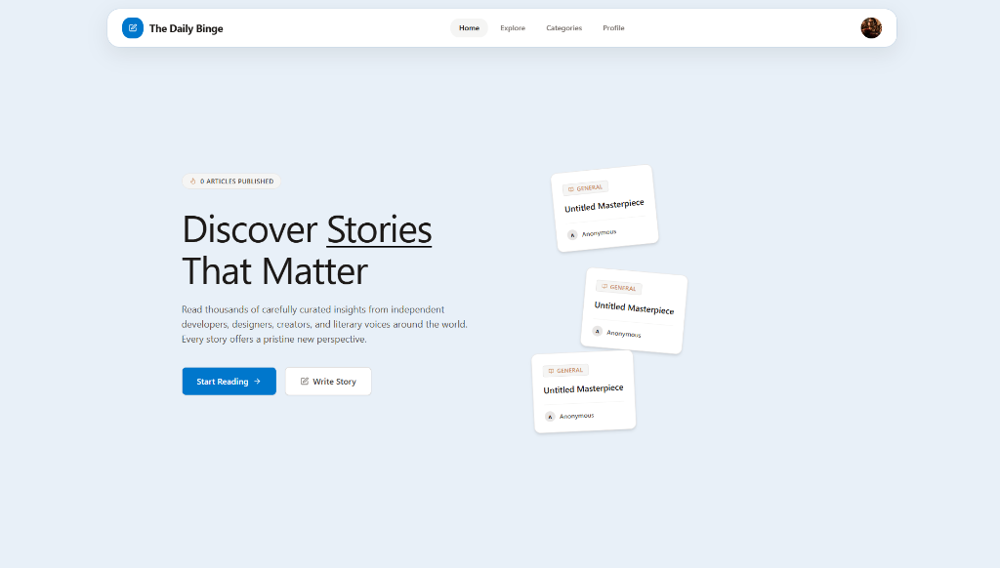

# The Daily Binge

A modern, full-stack digital publishing platform designed for writers, thinkers, and readers. The Daily Binge provides an editorial writing experience powered by an extensible rich-text editor, content discovery streams, reader engagement tools, and administrative controls.



---

## Overview

The Daily Binge was built to combine a distraction-free editorial experience with modern web performance standards. Writers get access to an intuitive WYSIWYG editor with live word counting, read-time estimations, cover uploads, and categorization. Readers get clean discovery feeds, responsive layouts, bookmarking, and discussion threads.

The architecture separates concerns cleanly between a fast React client built on Vite and a RESTful Express.js service backed by MongoDB.

---

## Key Features

### Editorial and Writing Experience
- **Tiptap Rich-Text Editor**: Custom-tailored block and inline formatting, image embeds, task lists, code blocks, highlighting, tables, and bubble menus.
- **Article Metadata**: Automated word count calculation, estimated reading times, tag management, and slug generation.
- **Media Management**: Cover photo and avatar uploads handled through Cloudinary CDN.
- **Draft and Publishing States**: Control story visibility with draft, public, and private publication toggles.

### Reader Discovery and Interaction
- **Curated Feeds**: Dedicated views for Trending stories, Latest publications, Editor Picks, and Category exploration.
- **Time-Filtered Views**: Sort articles by 24-hour windows, past week, month, or year.
- **Community Engagement**: Threaded comment sections, article likes, view count tracking, and personal reading bookmarks.
- **Author Profiles**: Public portfolio pages showcasing published work, reader metrics, social links, and author bios.

### Moderation and Administration
- **Admin Dashboard**: Centralized metrics tracking total articles, reader interactions, platform users, and engagement trends.
- **Content Moderation**: Feature stories, toggle comment availability per post, manage publication states, or delete content.
- **User Oversight**: Search, filter, and inspect registered authors and their published output.

### Security and Authentication
- **Dual Authentication**: Hybrid support for HTTP-only secure cookies and standard Authorization Bearer tokens.
- **Role-Based Access Control**: Strict middleware guards separating authenticated user actions from administrative features.
- **Account Verification**: Email verification and password resets powered by six-digit one-time passwords (OTP).

---

## Architecture and Tech Stack

```
The-Daily-Binge/
├── Blog Website/
│   ├── client/       # React 19 single-page application (Vite)
│   └── server/       # Node.js + Express 5 REST API
└── assets/           # Project screenshots and documentation media
```

### Frontend
- **Framework**: React 19
- **Build Tool**: Vite
- **Routing**: React Router v7
- **Styling**: Tailwind CSS, PostCSS
- **Animations**: Motion (Framer Motion)
- **Editor**: Tiptap Editor Suite
- **State Management**: Zustand (with local storage persistence)
- **HTTP Client**: Axios (configured with request interceptors and credential support)
- **Icons & Alerts**: Lucide React, React Toastify

### Backend
- **Runtime**: Node.js (ES Modules)
- **Framework**: Express 5
- **Database**: MongoDB with Mongoose ODM
- **Authentication**: JSON Web Tokens (JWT), Bcrypt password hashing, Cookie-Parser
- **File Uploads**: Multer with Cloudinary v2 SDK
- **Email Service**: Nodemailer (SMTP transport)
- **CORS & Proxying**: Dynamic origin filtering and reverse-proxy trust configuration

---

## Getting Started

### Prerequisites
- Node.js (v18 or higher recommended)
- MongoDB instance (local or MongoDB Atlas connection string)
- Cloudinary account (for image storage)
- SMTP credentials (such as Gmail App Password) for email delivery

---

### Installation

1. **Clone the repository**
   ```bash
   git clone https://github.com/Rohitbora07/The-Daily-Binge.git
   cd The-Daily-Binge
   ```

2. **Setup the Backend**
   ```bash
   cd "Blog Website/server"
   npm install
   ```
   Create a `.env` file in `Blog Website/server`:
   ```env
   PORT=5000
   NODE_ENV=development
   CLIENT_URL=http://localhost:5173
   JWT_SECRET=your_jwt_secret_key_here
   MONGODB_URI=mongodb+srv://<username>:<password>@cluster.mongodb.net/the-daily-binge

   # Email service
   EMAIL=your_email@gmail.com
   PASS=your_email_app_password

   # Cloudinary storage
   CLOUDINARY_CLOUD_NAME=your_cloud_name
   CLOUDINARY_API_KEY=your_api_key
   CLOUDINARY_API_SECRET=your_api_secret
   ```

   Start the backend in development mode:
   ```bash
   npm run dev
   ```

3. **Setup the Frontend**
   Open a second terminal window:
   ```bash
   cd "Blog Website/client"
   npm install
   ```
   Create a `.env` file in `Blog Website/client`:
   ```env
   VITE_BACKEND_URL=http://localhost:5000
   ```

   Start the client development server:
   ```bash
   npm run dev
   ```

4. **Access the application**
   Open your browser and navigate to `http://localhost:5173`.

---

## API Reference Overview

The Express backend exposes RESTful endpoints under `/api`:

### Authentication and Users (`/api/user`)
| Method | Endpoint | Description | Access |
|---|---|---|---|
| `POST` | `/api/user/register` | Register a new author account | Public |
| `POST` | `/api/user/login` | Authenticate user and issue token | Public |
| `POST` | `/api/user/logout` | Clear session and cookies | Public |
| `GET` | `/api/user/me` | Fetch current session profile | Authenticated |
| `PUT` | `/api/user/update-profile` | Update profile information and avatars | Authenticated |
| `POST` | `/api/user/send-verification-otp` | Request email verification code | Authenticated |
| `POST` | `/api/user/verify` | Verify email with OTP | Authenticated |
| `GET` | `/api/user/profile/:id` | Fetch public author profile and articles | Public |

### Articles and Content (`/api/blog`)
| Method | Endpoint | Description | Access |
|---|---|---|---|
| `GET` | `/api/blog/published/all-blogs` | Fetch paginated public articles | Public |
| `GET` | `/api/blog/single/:slug` | Retrieve single story by URL slug | Public |
| `GET` | `/api/blog/trending` | Fetch trending stories by engagement score | Public |
| `GET` | `/api/blog/featured` | Fetch editor-featured stories | Public |
| `GET` | `/api/blog/category/:category` | Filter stories by category | Public |
| `POST` | `/api/blog/create` | Publish or draft a new article | Authenticated |
| `PUT` | `/api/blog/update/:slug` | Edit existing article content | Authenticated |
| `DELETE` | `/api/blog/single/:slug/delete` | Remove an article | Authenticated |
| `PUT` | `/api/blog/:id/like` | Toggle article like counter | Authenticated |

### Comments and Bookmarks
| Method | Endpoint | Description | Access |
|---|---|---|---|
| `GET` | `/api/comments/blog/:blogId` | Retrieve article discussion thread | Public |
| `POST` | `/api/comments/post/:blogId` | Add comment or reply | Authenticated |
| `POST` | `/api/bookmark/add/:blogId` | Save story to user reading list | Authenticated |
| `DELETE` | `/api/bookmark/delete/:blogId` | Remove story from reading list | Authenticated |

### Administration (`/api/admin`)
| Method | Endpoint | Description | Access |
|---|---|---|---|
| `GET` | `/api/admin/stats` | Aggregate dashboard statistics | Admin Only |
| `GET` | `/api/admin/blog/all` | View and manage all platform content | Admin Only |
| `PUT` | `/api/admin/blog/:id/feature` | Toggle featured article status | Admin Only |
| `PUT` | `/api/admin/blog/:id/toggle-comments`| Enable or disable comments on a story | Admin Only |
| `DELETE` | `/api/admin/blog/:id/delete` | Delete moderation target | Admin Only |

---

## Production Deployment Notes

### Backend Hosting (Render, Railway, or VPS)
- **Working Directory**: Since the backend lives in `Blog Website/server`, configure the deployment build and start commands explicitly:
  - Build Command: `cd "Blog Website/server" && npm install`
  - Start Command: `cd "Blog Website/server" && npm start`
- **Reverse Proxy**: `app.set("trust proxy", 1)` is enabled to ensure secure cross-site cookies work behind Cloudflare or platform load balancers.
- **Database IP Access**: Ensure MongoDB Atlas Network Access includes `0.0.0.0/0` so dynamic cloud instances can connect.

### Frontend Hosting (Vercel, Netlify, or Cloudflare Pages)
- **Root Directory**: Set to `Blog Website/client`.
- **Environment Variable**: Set `VITE_BACKEND_URL` to your production backend URL (without trailing slashes).
- **SPA Rewrites**: Ensure your static host redirects all routes back to `/index.html` for client-side routing.

---

## License

This project is licensed under the ISC License.
